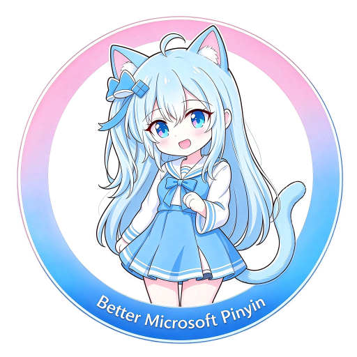
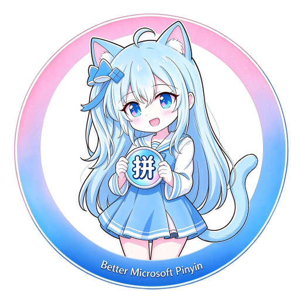

# Better Microsoft Pinyin

<p align="center">
  
  &nbsp;&nbsp;&nbsp;
  
</p>

<p align="center">
  <a href="LICENSE"></a>
  
  
  <a href="https://github.com/Yuooms/better-microsoft-pinyin"></a>
</p>

给 Windows 自带的**微软拼音**补三件事：**云联想、词库管理、输入统计**；顺带让它能自己检查更新。

- **云联想**：输入词库里没有的词（游戏角色名、专有名词、新词）时，从 Bing 搜索建议取回候选，显示在候选条旁边，按一下采纳键即可上屏。
- **词库管理**：把微软拼音的自定义短语与自学习词做成可视化列表，可搜索、导入导出、批量删除；删除前自动备份，能回退。
- **输入统计**：在本机按天、按小时、按程序累计输入量，用柱状图与程序排行回看。默认关闭，纯本地。
- **检查更新**：「关于」页读 GitHub 的最新发布。启动时每天查一次，**只提示、不自动下载**；下载与安装都由你点，下载包落在本机缓存目录里，随时能打开或清掉。

不替换输入法、不注入进程、不修改微软拼音本体。原有候选、快捷键、自学习行为完全不变；关掉本程序，一切恢复原状。

> 本项目是非官方第三方工具，与 Microsoft Corporation 无隶属关系；「微软拼音」是 Microsoft 的商标。

## 云联想：本地没有的词

微软拼音的本地词库很稳，但遇到「若娜瓦」这类新词就无能为力 —— 候选条里只有「若纳瓦」「若」「弱」「偌」「箬」。本程序在候选条下方补一个浮窗：

```
┌───────────────────────────────────────────┐
│ 1 若纳瓦  2 若  3 弱  4 偌  5 箬          │  ← 微软拼音自己的候选，原样不动
└───────────────────────────────────────────┘
   ☁ 若娜瓦                            ·    ← 严格云联想：本地没有这个词，按 · 上屏
   ☁ 若娜瓦壁纸                        6
   ☁ 若娜瓦英文                        7
   ☁ 若娜瓦图片                        8
```

- **云联想**：字数与输入完全相等的整词，例如 `yisitalu` → 「伊斯塔露」。默认用 `·` 采纳。
- **扩展云联想**：以当前拼音开头的更长词，例如 `ruonawa` → 「若娜瓦壁纸」。默认关闭，打开后数字键自动接在本地候选之后。
- **注意上图的「一字之差」**：本地第 1 位是「若**纳**瓦」（纳），云联想补的是「若**娜**瓦」（娜）——「若娜瓦」本来不在本地词库里，`·` 才打得出来。`6/7/8` 是本地候选数（5）之后的数字键；默认只开整词云联想，上图这几行扩展需要自己打开。

几条设计取舍：

- **严格 / 扩展分离**：`lianxiang` 不会再把「联想电脑管家」当成你要的词；严格槽只给字数相等的那一条。
- **本地已有就不显示**：云候选与本地候选重复时自动让位，避免「云联想没带来新信息」。
- **读得通才显示**：内置 15 万词的读音词库，候选必须与输入逐音节对得上；简拼（`ystl`）会先展开成全拼再查云端。
- **不抢焦点**：浮窗带 `WS_EX_NOACTIVATE`，永远不会让输入法误提交组字；点击穿透。
- **键位可自定义**：默认采纳键是 `·`，避开被微软拼音自身占用的 Tab；点一下方框再按键盘就能改成别的键。扩展键是一个列表，可以增删、拖动排序，最多 4 个，提交前还会复核一次。

## 词库管理：看得见、删得掉、退得回

微软拼音的词库平时只能靠「设置 → 词库」看一个文本框。这里把它拆成两个可操作的列表：

**自定义短语（`ChsPinyinEUDPv1.lex` / `v2.lex`）**

- 直接查看、添加、编辑、删除；支持多选批量删除，也能导入导出 txt。
- 采纳过云词后自动写入这里，几秒内原生候选即可见，不需要重启输入法。
- 同一条短语会写两条记录（`yisitalu` 与 `ystl`）：输入法只按拼音字段做字符串匹配，不会自己推简拼。
- 实测（Win10 19045）输入法不按记录里的「位置」排序，自定义短语一律排在原生候选第 1 位；本程序如实标注，不假装支持。

**自学习词库（`ChsPinyinUDL.dat`）**

- 读出输入法自己学到的词，可搜索、按简拼过滤、导出 CSV。
- 勾选不再需要的词批量删除：按输入法自己的方式把槽位标记成空，再让它重新加载，几秒内生效。
- 写前自动备份到 `%APPDATA%\BetterPinyin\udl-backup`；「备份…」窗口能看每份备份的时间与词条数，预览恢复会带回哪些词、又带走哪些词，再决定恢复到哪一份或删掉哪份。恢复前同样自动备份，所以恢复本身也能撤。

> 只能删自学习里已有的词，不能新增或改词——新增走「自定义短语」。删除只影响原生候选，不改本程序用户词库里「采纳过什么」的记录。

## 输入统计：知道自己打了多少

默认关闭，只在本地累计，不上传。打开后按天记录：

- **今天**：组字次数、拼音字母数、云词采纳次数、云词上屏字数。
- **趋势**：今天（24 根小时柱）/ 近 7 天 / 近 30 天 / 本月，柱状图带纵轴，可切「组字次数 / 拼音字母数」。
- **程序排行**：输入发生在哪些程序里（只记进程名，例如 `Code`，不记窗口标题与路径）。
- **保留期**：最近 30 天 / 90 天 / 一年 / 永久；「清空全部历史」直接删文件，不保留备份。

**口径要说清**：拿不到微软拼音原生上屏的汉字数——输入法是通过 TSF 在目标程序进程内提交文本的，跨进程没有受支持的读法。所以柱高只能是「组字次数」或「拼音字母数」；唯一真实的上屏字数来自云词采纳（我们自己注入的，长度已知）。UWP 应用的窗口都挂在 `ApplicationFrameHost` 上，只能如实记成「UWP 应用」。

## 其它特性

- **开机启动可开关**：设置 → 常规里开关。只写当前用户的 Run 键，不需要管理员权限；登录后只在托盘运行，不弹设置窗口。程序被移动或重新发布后，下次启动会自动把登记路径改到新位置。
- **Fluent 设置界面**：基于 WPF-UI 4.3.0，自绘标题栏、图标导航与卡片式设置项；支持浅色 / 深色 / 跟随系统，Windows 11 上可开 Mica 让壁纸透过窗口，也可以铺一张自定义背景图（带透明度）。Windows 10 自动用纯色底。
- **隐私克制**：只发送当前输入串，不发送应用名、上下文或任何可识别身份的信息；没有遥测。

## 系统要求

- Windows 10 2004 及以上，x64（Windows 11 24H2 已实测，见 [技术笔记](docs/TECH-NOTES.md)）
- 微软拼音（系统自带）
- 不需要管理员权限

## 安装

### 使用发布版

到 [Releases](https://github.com/Yuooms/better-microsoft-pinyin/releases) 下载 `BetterMicrosoftPinyin-v0.1.0-win-x64.zip`，解压到任意目录，运行 `BetterMicrosoftPinyin.exe`。压缩包里自带 .NET 运行时，不用另外安装。

### 从源码构建

```bash
dotnet build -c Release
dotnet run --project src/BetterPinyin.App
```

启动后常驻托盘。首次运行会自动打开设置窗口，可以直接在那里试。

> 从源码构建需要 .NET 8 SDK。仓库里的 `NuGet.config` 已经把镜像排在前面，网络受限环境也能还原。
> 打发布包见 [发布说明](docs/RELEASE.md)。

## 使用

**云联想**：用微软拼音正常输入，例如 `yisitalu`。候选条旁边出现云候选时：

- 按 `·`（数字 1 左侧）采纳云联想的整词；
- 扩展云联想默认关闭：打开后按 `6` / `7` / `8` 采纳（编号接在本地候选之后，浮窗上有提示）；
- 不想用就继续打字，浮窗会自行消失。

以上都可以在「设置 → 云联想」里调整：两种联想各自开关、采纳键、扩展条数与键位、浮窗位置（下方 / 左侧）与样式。

**词库**：打开「设置 → 词库」，在「自定义短语」与「自学习」两个标签间切换。改动即时写入输入法数据文件；删除自学习词时程序会自动切一次键盘布局让输入法重读。「采纳后自动写入」默认开启，但扩展云联想多是整句，默认只上屏、不写进短语；想让它们也写进来，打开旁边的「扩展词也写入短语」。

**输入统计**：打开「设置 → 输入统计」，先打开「在本机记录输入统计」。之后回到这一页即可看今天的数字、趋势图与程序排行；不要了可以随时关掉开关或清空历史。

**更新**：打开「设置 → 关于」，点「检查更新」读取 GitHub 上的最新发布。发现新版本时只提示，不会自己下载；点「下载更新」把安装包存到 `%LOCALAPPDATA%\BetterPinyin\updates`（卡片里会显示实际路径和占用大小，可以「打开文件夹」或「清理」），再点「安装并重启」才会替换并重启。启动时每天最多查一次，可以在同一张卡片里关掉。安装目录没有写权限（例如放在 `Program Files`）时不会硬来，会提示手动解压覆盖。

## 隐私

只把当前输入串（例如 `yisitalu`）发给你选择使用的搜索建议接口。不发送正在输入的应用名、上下文、剪贴板或任何账号信息。配置与日志都保存在本机：

- 设置：`%APPDATA%\BetterPinyin\settings.json`
- 日志：`%LOCALAPPDATA%\BetterPinyin\logs\app.log`（只记事件与异常，不记输入内容）
- 用户词库：`%APPDATA%\BetterPinyin\words.json`（采纳过哪些云词，用于浮窗排序）
- 输入统计：`%APPDATA%\BetterPinyin\statistics.json`（默认关闭；只记计数与进程名，不记输入内容，也不上传）

检查更新只读取 GitHub 上本仓库的公开发布信息（版本号、发布时间、下载地址），每天最多一次，可以在「关于」页关掉；下载更新时也只从这个仓库的发布页取文件。

统计开关默认关闭。开启后程序会在本机记录「哪些程序里打了多少」，用的只有进程名（例如 `Code`），不记窗口标题、不记文件路径；「清空全部历史」会直接删掉文件，不保留备份。

## 已知限制

- 以**管理员身份运行**的程序里无法上屏（系统权限隔离，属于 Windows 的限制）；这些程序里的输入也不会被统计到。
- 全屏独占游戏、部分反作弊环境不支持。
- 纯缩写（`ystl`）依赖内置词库展开；词库没有的新专名（例如「伊斯塔露」本身）无法展开，此时只有全拼能命中。
- 双拼用户需在设置里勾选「我使用双拼」，此时云联想自动停用（双拼的按键串不是全拼，无法还原读音）。
- 英文模式下采纳会删除已输入的字母，上屏前会用 UIA 校验文本尾部确实是刚输入的串；控件不支持 ValuePattern 时会放弃上屏。该功能默认关闭。
- 托盘右键菜单仍是系统绘制的浅色（`ContextMenuStrip` 无法跟随应用主题）。
- 窗口材质（Mica）需要 Windows 11 22H2（build 22621）及以上；Windows 10 与更早的 Windows 11 上设置窗口自动使用纯色底，可以在「外观」里用一张背景图补观感。
- 候选浮窗的「亚克力」样式走的是自研 `SetWindowCompositionAttribute`，与设置窗口无关；它只覆盖一个小窗口，不存在拖动掉帧问题。
- **改不了微软拼音的词库内容**：能删掉自学习里已有的词，但不能新增或改词。新增走它的「用户定义的短语」，能进原生候选，但实测（Win10 19045）输入法不按记录里的「位置」排序，自定义短语一律排在候选第 1 位。
- **删自学习词要向输入法借一次键盘布局切换**：输入法只在布局从中文切走再切回时重读词库，程序会自动做这一步并切回原来的布局；如果本机只装了微软拼音一种布局，需要先加一个英文键盘，或注销后重新登录。
- **删除自学习词只影响原生候选**：它不改本程序用户词库里的同名记录（那里存的是「采纳过什么」，用于浮窗排序）。
- **输入统计不是输入法的官方统计**：它统计本程序通过键盘钩子观测到的输入，关掉托盘程序后不再累计；原生上屏的汉字数读不到，详见上面的口径说明。
- **自动更新要求安装目录可写**：放在 `Program Files` 或只读盘时不会强行替换，只会提示手动解压；检查更新也依赖 GitHub，走不了镜像。
- **更新包不会自动清理**：下载后一直留在缓存目录占空间，装完或不想装了在「关于」页点「清理」；程序不会替你删。

## 项目结构

```
src/BetterPinyin.Contracts   跨进程契约与接入层抽象
src/BetterPinyin.Core        业务核心（云查询、读音校验、分区、词库、统计、更新解析、设置、模块框架）
src/BetterPinyin.Interop     Win32 / COM / UI Automation 封装（含共享键盘中枢）
src/BetterPinyin.App         WPF 客户端（托盘、浮窗、设置、词库页、统计页、自更新）
src/BetterPinyin.Tests       零依赖测试
tools/ImeProbe               输入法环境诊断探针
tools/LexiconBuilder         内置词库构建器
tools/BrandBuilder           品牌图片与 app.ico 生成器（仅标准库）
assets/lexicon.bin           内置词库（构建产物，随仓库提交）
assets/brand/                应用图标与介绍图（由 LOGO/ 源图生成）
docs/                        架构、开发、扩展、排障、词库、发布、路线图
```

## 进一步阅读

- [架构说明](docs/ARCHITECTURE.md)
- [开发指南](docs/DEVELOPMENT.md)
- [新增一个功能模块](docs/FEATURE-GUIDE.md)
- [内置词库](docs/LEXICON.md)
- [技术笔记：候选窗、读音判定、输入统计口径、窗口材质、自更新](docs/TECH-NOTES.md)
- [排障指南](docs/TROUBLESHOOTING.md)
- [发布说明](docs/RELEASE.md)
- [发布说明](docs/RELEASE.md)
- [路线图](docs/ROADMAP.md)

## 作者

由 [Yuooms](https://github.com/Yuooms) 开发与维护。问题、建议或新词需求欢迎在 [项目仓库](https://github.com/Yuooms/better-microsoft-pinyin/issues) 提 Issue。

## 开源协议

[MIT](LICENSE)，Copyright (c) 2026 Yuooms。可自由使用、修改与再分发，请保留版权与许可声明。

运行期依赖 WPF-UI（MIT）；内置词库的数据来源与许可、以及界面思路参考（BetterGI，未引入代码）见 [THIRD-PARTY-NOTICES.md](THIRD-PARTY-NOTICES.md)。
